# 🐍 Awesome Python Version Managers

<p align="center">
  
</p>

<p align="center">
  <a href="https://github.com/ishandutta2007/Awesome-Awesome-Awesome"></a><a href="https://discord.gg/jc4xtF58Ve"></a> <a href="https://github.com/ishandutta2007/Awesome-Python-Version-Managers/stargazers"></a> <a href="https://github.com/ishandutta2007/Awesome-Python-Version-Managers/network/members"></a> <a href="LICENSE"></a> <a href="#-how-to-contribute"></a> <a href="https://github.com/ishandutta2007"></a>
</p>

---

## 📖 Overview & Ecosystem Guide

A curated, comprehensive guide to the **Python Version Managers Ecosystem**, covering both high-performance **Open-Source GitHub Projects** and cloud-hosted **SaaS CI/CD Platforms**. 

Managing multiple Python runtimes, resolving interpreter isolation issues, avoiding PATH collisions, and enforcing deterministic cross-platform lockfiles are fundamental challenges for modern software engineering teams, data science practitioners, and DevOps pipelines. This repository catalogues the leading tools—from source-compilation tools (`pyenv`) and unified Rust toolchains (`uv`) to polyglot runtime switchers (`mise`, `asdf`), scientific distributions (`Conda`), and reproducible workflow orchestrators.

---

## 📑 Table of Contents

- [🐍 Awesome Python Version Managers](#-awesome-python-version-managers)
  - [📖 Overview \& Ecosystem Guide](#-overview--ecosystem-guide)
  - [📑 Table of Contents](#-table-of-contents)
  - [🌐 Sector Overview \& Market Dynamics](#-sector-overview--market-dynamics)
  - [☁️ Hosted Platforms \& SaaS Toolchains](#️-hosted-platforms--saas-toolchains)
  - [⚡ Open-Source Python Version Managers \& Toolchains](#-open-source-python-version-managers--toolchains)
    - [📊 At-a-Glance Comparison Matrix](#-at-a-glance-comparison-matrix)
    - [1. uv](#1-uv-)
    - [2. pyenv](#2-pyenv-)
    - [3. mise](#3-mise-)
    - [4. Poetry](#4-poetry-)
    - [5. asdf](#5-asdf-)
    - [6. Pipenv](#6-pipenv-)
    - [7. Rye](#7-rye-)
    - [8. pipx](#8-pipx-)
    - [9. PDM](#9-pdm-)
    - [10. pixi](#10-pixi-)
    - [11. Conda](#11-conda-)
    - [12. pyenv-win](#12-pyenv-win-)
    - [13. Hatch](#13-hatch-)
    - [14. virtualenv](#14-virtualenv-)
    - [15. tox](#15-tox-)
    - [16. Nox](#16-nox-)
    - [17. Pyflow](#17-pyflow-)
  - [🎯 Decision Matrix: Choosing the Right Manager](#-decision-matrix-choosing-the-right-manager)
  - [🤝 How to Contribute](#-how-to-contribute)
  - [📈 Star History](#-star-history)
  - [💖 Support \& Community](#-support--community)
  - [⚠️ Disclaimer](#️-disclaimer)

---

## 🌐 Sector Overview & Market Dynamics

The global market for Continuous Integration & Continuous Delivery (CI/CD) pipelines, developer runtime environments, and automated infrastructure provisioning is currently estimated at **$2.6 Billion to $11.8 Billion in 2026**, on track to expand toward **$25 Billion to $35 Billion by the early 2030s** at an expanding compound annual growth rate (CAGR) of 18%–22%.

The hosted enterprise developer platform space is **moderately concentrated**—dominated by top-tier cloud providers and hyperscalers (Microsoft GitHub, Alphabet Google Cloud, AWS, Atlassian, and GitLab) capturing a near "winner-take-most" share for enterprise orchestration. Conversely, local developer workstations and client-side Python runtime management remain **highly dynamic and fragmented**, driven by next-generation Rust-native orchestrators (`uv`, `mise`, `pixi`) rapidly displacing legacy source-compilation workflows (`pyenv`, `virtualenv`).

---

## ☁️ Hosted Platforms & SaaS Toolchains

The following hosted CI/CD and developer environment platforms manage Python versions, interpreter matrices, and virtual environments at cloud scale. Entries are sorted in **descending order by company valuation / market capitalization**.

| 🏢 Platform | 💰 Company Valuation / Revenue | 🛠️ Key Capabilities & Python Runtime Features | 🏷️ Starting Tier Pricing | 🎁 Free Tier Limits |
| :--- | :--- | :--- | :--- | :--- |
| **[GitHub Actions](https://github.com/features/actions)** (`actions/setup-python`) | **Microsoft**<br>• Valuation: ~$3.1 Trillion<br>• Revenue: ~$245B+ | Managed runner action for installing and pinning Python versions across Ubuntu, macOS, and Windows. Auto-detects `.python-version` files, caches pip/poetry/pipenv dependencies, and powers cross-version matrix testing. | **$4.00 / user / month** (GitHub Team tier; additional Linux compute billed at $0.008 / min) | **2,000 build minutes/month** on private repos (100% free & unlimited for public repositories) + 500 MB artifact storage free forever. |
| **[Google Cloud Build](https://cloud.google.com/build)** | **Alphabet (Google)**<br>• Valuation: ~$2.1 Trillion<br>• Revenue: ~$307B+ | Serverless CI/CD build platform supporting custom and community Python builder containers. Integrates directly with Artifact Registry, Google Kubernetes Engine (GKE), and Cloud Run. | **$0.003 / build-minute** for default 1-vCPU `e2-medium` Linux machine | **120 build-minutes per day** (~3,600 build-minutes/month) free forever across default standard machine pools. |
| **[AWS CodeBuild](https://aws.amazon.com/codebuild/)** | **Amazon**<br>• Valuation: ~$1.9 Trillion<br>• Revenue: ~$575B+ | Fully managed build service that compiles Python applications, runs unit tests, and packages artifacts with curated Amazon Linux and Ubuntu Python runtime container images. | **$0.005 / build-minute** for `build.general1.small` (2 vCPUs, 3 GB RAM Linux) | **100 build-minutes per month** of `build.general1.small` free forever through standard AWS Free Tier. |
| **[Bitbucket Pipelines](https://bitbucket.org/product/features/pipelines)** | **Atlassian**<br>• Valuation: ~$45 Billion<br>• Revenue: ~$4.3B+ | Integrated CI/CD in Bitbucket Cloud using Docker containers to define arbitrary Python versions and build matrices with out-of-the-box dependency caching. | **$3.00 / user / month** (Bitbucket Standard tier; includes 2,500 build minutes/month) | **50 build-minutes per month** and 1 GB Git Large File Storage (LFS) free forever for teams up to 5 users. |
| **[GitLab CI/CD](https://about.gitlab.com/stages-devops-lifecycle/continuous-integration/)** | **GitLab Inc.**<br>• Valuation: ~$8.5 Billion<br>• Revenue: ~$580M+ | Complete DevSecOps platform with Auto DevOps, containerized Python version testing, `.gitlab-ci.yml` matrix builds, and runner autoscaling. | **$29.00 / user / month** (GitLab Premium tier; extra compute packs at $10 / 1,000 compute minutes) | **400 compute minutes per month** and 5 GB storage free forever for Free tier namespaces. |
| **[CircleCI](https://circleci.com/)** | **CircleCI**<br>• Valuation: ~$1.7 Billion (Series F)<br>• Revenue: ~$100M+ ARR | Cloud-native CI/CD featuring dedicated Python Orbs, pre-built Docker convenience images for all CPython versions, automated test splitting, and concurrency parallelism. | **$15.00 / month** (Performance plan includes 30,000 credits/month and 3 user seats; $0.0006/credit) | **6,000 build credits per month** (approx. 600 Linux build minutes) free forever with up to 30 concurrent jobs. |

---

## ⚡ Open-Source Python Version Managers & Toolchains

The following open-source projects provide local interpreter installation, version switching, virtual environment isolation, and dependency resolution. Entries are **strictly sorted in descending order by GitHub stargazers count**, with direct links to their stargazers page on each social badge.

### 📊 At-a-Glance Comparison Matrix

| Project | GitHub_Stars | Implementation Language | Interpreter Installation | Version Pinning File | Primary Specialty |
| :--- | :--- | :--- | :--- | :--- | :--- |
| **[uv](#1-uv-)** | [](https://github.com/astral-sh/uv/stargazers) | Rust | Precompiled Binaries | `.python-version`, `pyproject.toml` | All-in-one ultra-fast toolchain |
| **[pyenv](#2-pyenv-)** | [](https://github.com/pyenv/pyenv/stargazers) | Shell / C | Source Compilation | `.python-version` | Battle-tested CPython build standard |
| **[mise](#3-mise-)** | [](https://github.com/jdx/mise/stargazers) | Rust | Precompiled / Source | `.mise.toml`, `.tool-versions` | Polyglot runtime & environment manager |
| **[Poetry](#4-poetry-)** | [](https://github.com/python-poetry/poetry/stargazers) | Python | External / System | `pyproject.toml`, `poetry.lock` | Deterministic dependency & package locking |
| **[asdf](#5-asdf-)** | [](https://github.com/asdf-vm/asdf/stargazers) | Shell / Elixir | Plugin-driven | `.tool-versions` | Classic multi-language runtime switcher |
| **[Pipenv](#6-pipenv-)** | [](https://github.com/pypa/pipenv/stargazers) | Python | External / pyenv | `Pipfile`, `Pipfile.lock` | Standard PyPA venv & packaging combo |
| **[Rye](#7-rye-)** | [](https://github.com/astral-sh/rye/stargazers) | Rust | Standalone Binaries | `.python-version`, `pyproject.toml` | Opinionated all-in-one toolchain prototype |
| **[pipx](#8-pipx-)** | [](https://github.com/pypa/pipx/stargazers) | Python | External / System | System isolated | Isolated CLI application runner |
| **[PDM](#9-pdm-)** | [](https://github.com/pdm-project/pdm/stargazers) | Python | External / System | `pdm.lock`, `pyproject.toml` | PEP 582 & PEP 621 package manager |
| **[pixi](#10-pixi-)** | [](https://github.com/prefix-dev/pixi/stargazers) | Rust | Conda-forge Binaries | `pixi.toml`, `pixi.lock` | Fast conda-based multi-language solver |
| **[Conda](#11-conda-)** | [](https://github.com/conda/conda/stargazers) | Python | Precompiled Binaries | `environment.yml` | Scientific computing & C-library isolation |
| **[pyenv-win](#12-pyenv-win-)** | [](https://github.com/pyenv-win/pyenv-win/stargazers) | PowerShell / Batch | Official Windows Installers | `.python-version` | Native Windows port of pyenv |
| **[Hatch](#13-hatch-)** | [](https://github.com/pypa/hatch/stargazers) | Python | Standalone Binaries | `hatch.toml`, `pyproject.toml` | Standards-compliant project manager |
| **[virtualenv](#14-virtualenv-)** | [](https://github.com/pypa/virtualenv/stargazers) | Python | External / System | Local Directory | Low-level environment isolation baseline |
| **[tox](#15-tox-)** | [](https://github.com/tox-dev/tox/stargazers) | Python | External / Multiple | `tox.ini` | Automated matrix testing across Pythons |
| **[Nox](#16-nox-)** | [](https://github.com/wntrblm/nox/stargazers) | Python | External / Multiple | `noxfile.py` | Python-configured test environment matrix |
| **[Pyflow](#17-pyflow-)** | [](https://github.com/David-OConnor/pyflow/stargazers) | Rust | Standalone Binaries | `pyproject.toml` | Zero-configuration Python project manager |

---

### 1. [uv](https://github.com/astral-sh/uv) [](https://github.com/astral-sh/uv/stargazers)

- **License:** MIT / Apache-2.0
- **Implementation:** Rust (Astral)
- **Primary Function:** Comprehensive, blazing-fast Python toolchain designed to replace `pip`, `pip-tools`, `pipx`, `poetry`, `pyenv`, `twine`, and `virtualenv`.
- **Key Features:**
  - `uv python install 3.12 3.13 3.14`: Installs multiple precompiled Python builds in under a single second with PGO (Profile-Guided Optimization) and BOLT compiler optimizations enabled.
  - Transparent project execution with `uv run`, executing commands inside isolated environments without requiring manual virtualenv activation.
  - Universal, cross-platform lockfile (`uv.lock`) ensuring deterministic environments across Linux, macOS, and Windows.
  - High-performance resolver and installer operating 10–100x faster than traditional pip workflows.
- **Trade-offs:** Exclusively enforces modern PEP 517 build standards; legacy packages relying strictly on archaic unmaintained `setup.py` scripts may require pip fallback.

---

### 2. [pyenv](https://github.com/pyenv/pyenv) [](https://github.com/pyenv/pyenv/stargazers)

- **License:** MIT
- **Implementation:** Pure Shell & C shims
- **Primary Function:** The classic UNIX standard for installing and switching between multiple CPython, PyPy, and GraalPython runtimes.
- **Key Features:**
  - Shims intercept `python`, `pip`, and other binaries on `$PATH`, dynamically redirecting to the active version.
  - Directory-level version selection via committed `.python-version` files.
  - Extensive support for custom compile flags, patches, debug builds, and specialized distributions (e.g., Anaconda, Miniconda, stackless).
  - Vast ecosystem of plugins, including `pyenv-virtualenv`, `pyenv-which-ext`, and `pyenv-update`.
- **Trade-offs:** Builds Python directly from source code by default, requiring operating system development headers (`zlib1g-dev`, `libssl-dev`, `libffi-dev`) and taking several minutes per version installation.

---

### 3. [mise](https://github.com/jdx/mise) [](https://github.com/jdx/mise/stargazers)

- **License:** MIT
- **Implementation:** Rust
- **Primary Function:** The modern, high-performance polyglot development environment tool (formerly known as `rtx`) that supersedes `asdf`.
- **Key Features:**
  - Manages Python alongside Node.js, Go, Rust, Ruby, Java, Terraform, and dozens of CLI tools under a unified configuration.
  - Reads `.tool-versions`, `.mise.toml`, and `.python-version` files automatically on directory change (`cd`).
  - Downloads precompiled Python binaries by default with fallback to `python-build`.
  - Integrates task runner functionality (`mise run build`) and environment variable management (`.env` replacement).
  - Supports bidirectional syncing with existing pyenv or uv installations (`mise sync python --uv`).
- **Trade-offs:** Broader surface area than single-language tools; compiling from source requires manual installation of OS C development dependencies.

---

### 4. [Poetry](https://github.com/python-poetry/poetry) [](https://github.com/python-poetry/poetry/stargazers)

- **License:** MIT
- **Implementation:** Python
- **Primary Function:** End-to-end dependency management, packaging, and publishing tool for Python projects.
- **Key Features:**
  - Standardized configuration utilizing `pyproject.toml` and deterministic locking via `poetry.lock`.
  - Automatically provisions and manages dedicated virtualenvs per project directory.
  - Expressive dependency specification with version constraints, optional extras, and build group tagging.
  - Built-in publishing workflow directly targeting PyPI or private package indexes.
- **Trade-offs:** Does not compile or download Python runtimes itself; requires an existing Python interpreter provisioned via `uv`, `pyenv`, or system package managers.

---

### 5. [asdf](https://github.com/asdf-vm/asdf) [](https://github.com/asdf-vm/asdf/stargazers)

- **License:** MIT
- **Implementation:** Shell / Elixir
- **Primary Function:** Extensible multi-runtime version manager powered by community plugins.
- **Key Features:**
  - Single CLI command interface (`asdf install python 3.12.0`) to manage runtimes across polyglot stacks.
  - Unified configuration file (`.tool-versions`) specifying exact pinned versions for Python, Ruby, Node, etc.
  - Giant plugin catalog (`asdf-community/asdf-python`) backed by battle-tested pyenv build machinery.
- **Trade-offs:** Shim execution introduces shell startup latency compared to compiled binary managers; plugin installation relies on external scripts.

---

### 6. [Pipenv](https://github.com/pypa/pipenv) [](https://github.com/pypa/pipenv/stargazers)

- **License:** MIT
- **Implementation:** Python (PyPA)
- **Primary Function:** Python development workflow tool combining `pip` and `virtualenv` into a single tool.
- **Key Features:**
  - Employs `Pipfile` and cryptographic hash-checked `Pipfile.lock` to guarantee reproducible installations.
  - Can automatically trigger `pyenv` to install matching Python versions when a requested version is absent.
  - Integrated safety checking to audit installed dependencies for known CVE vulnerabilities.
- **Trade-offs:** Historically slower dependency resolution on complex dependency graphs; largely supplanted by newer tools (`uv`, `poetry`, `pdm`).

---

### 7. [Rye](https://github.com/astral-sh/rye) [](https://github.com/astral-sh/rye/stargazers)

- **License:** MIT / Apache-2.0
- **Implementation:** Rust (Created by Armin Ronacher, maintained by Astral)
- **Primary Function:** An opinionated, all-in-one Python management tool that spearheaded modern standalone Python binary management.
- **Key Features:**
  - Automatically fetches and installs portable, precompiled Python runtimes from `indygreg/python-build-standalone`.
  - Manages dependencies, workspace virtualenvs, formatting, and linting.
  - Compatible with standard `pyproject.toml` configurations.
- **Trade-offs:** Now in maintenance mode as Astral concentrates primary toolchain evolution into `uv`.

---

### 8. [pipx](https://github.com/pypa/pipx) [](https://github.com/pypa/pipx/stargazers)

- **License:** MIT
- **Implementation:** Python (PyPA)
- **Primary Function:** Install and run Python CLI applications in globally isolated virtual environments.
- **Key Features:**
  - Prevents global site-package contamination by isolating each CLI tool (e.g., `black`, `flake8`, `httpie`, `ruff`) into its own venv.
  - Automatically exposes application entry points onto your `$PATH`.
  - One-off command execution via `pipx run <tool>` without permanent installation.
- **Trade-offs:** Intended exclusively for end-user executable applications, not for library development or project dependency management.

---

### 9. [PDM](https://github.com/pdm-project/pdm) [](https://github.com/pdm-project/pdm/stargazers)

- **License:** MIT
- **Implementation:** Python
- **Primary Function:** Modern Python package and dependency manager supporting PEP 582 local package directories and PEP 621 metadata.
- **Key Features:**
  - Fast dependency resolution utilizing dedicated cross-platform lockfiles (`pdm.lock`).
  - Supports both standard virtualenv modes and PEP 582 `__pypackages__` mode without virtualenv activation.
  - Flexible build backend and rich plugin architecture.
- **Trade-offs:** Requires an external Python interpreter installed on the host machine.

---

### 10. [pixi](https://github.com/prefix-dev/pixi) [](https://github.com/prefix-dev/pixi/stargazers)

- **License:** BSD-3-Clause
- **Implementation:** Rust (prefix-dev)
- **Primary Function:** High-performance package management and environment reproducible workflows built upon the conda-forge ecosystem.
- **Key Features:**
  - Extremely fast SAT-solver written in Rust (`rattler`), solving environments exponentially faster than traditional Conda/Mamba.
  - Cross-platform reproducibility across Linux, macOS, and Windows via `pixi.lock`.
  - Installs non-Python system and binary dependencies (CUDA, C++, compilers, OpenSSL) seamlessly alongside Python runtimes.
- **Trade-offs:** Relies primarily on conda package channels rather than vanilla PyPI wheels, though PyPI dependencies are supported via mixed workflows.

---

### 11. [Conda](https://github.com/conda/conda) [](https://github.com/conda/conda/stargazers)

- **License:** BSD-3-Clause
- **Implementation:** Python
- **Primary Function:** Cross-platform package and environment manager for data science, machine learning, and scientific computing.
- **Key Features:**
  - Treats Python itself as an ordinary installable package inside each environment, enabling effortless switching.
  - Provides precompiled binaries for heavy C/C++/Fortran mathematical libraries (NumPy, SciPy, PyTorch).
  - Ecosystem backed by the extensive community-curated `conda-forge` repository.
- **Trade-offs:** Solver times can be significant in large environments; heavier disk footprint compared to lightweight venv managers.

---

### 12. [pyenv-win](https://github.com/pyenv-win/pyenv-win) [](https://github.com/pyenv-win/pyenv-win/stargazers)

- **License:** MIT
- **Implementation:** PowerShell & Windows Batch
- **Primary Function:** Windows-native port of `pyenv` allowing seamless version installation and switching without WSL.
- **Key Features:**
  - Directly downloads and installs official 32-bit and 64-bit Windows Python installer binaries.
  - Shim-based architecture that intercepts `python`, `pip`, and related commands in cmd.exe and PowerShell.
  - Respects per-directory `.python-version` files.
- **Trade-offs:** Limited to official pre-built Windows installers; cannot compile custom CPython source variants or apply arbitrary Unix patches.

---

### 13. [Hatch](https://github.com/pypa/hatch) [](https://github.com/pypa/hatch/stargazers)

- **License:** MIT
- **Implementation:** Python (PyPA)
- **Primary Function:** Modern, standards-compliant project manager and build backend (`hatchling`).
- **Key Features:**
  - Built-in interpreter management that downloads portable standalone Python distributions on demand.
  - Declarative environment matrices supporting complex testing across multiple Python versions (`hatch test`).
  - Full adherence to modern PyPA PEP specifications (`pyproject.toml`).
- **Trade-offs:** Focuses on overall project lifecycle rather than acting purely as a transparent global shim manager.

---

### 14. [virtualenv](https://github.com/pypa/virtualenv) [](https://github.com/pypa/virtualenv/stargazers)

- **License:** MIT
- **Implementation:** Python (PyPA)
- **Primary Function:** The foundational environment isolation utility in the Python ecosystem.
- **Key Features:**
  - Rapidly provisions isolated directory structures with dedicated `site-packages` folders.
  - Offers speed improvements, discovery heuristics, and upgrade hooks beyond the standard library `venv` module.
  - Serves as the core isolation engine beneath Poetry, Tox, Nox, and numerous other tools.
- **Trade-offs:** Does not manage, download, or switch Python interpreter versions; requires an existing Python binary.

---

### 15. [tox](https://github.com/tox-dev/tox) [](https://github.com/tox-dev/tox/stargazers)

- **License:** MIT
- **Implementation:** Python
- **Primary Function:** Generic virtualenv management and test automation command line tool.
- **Key Features:**
  - Automates testing across multiple Python versions (e.g., `py310`, `py311`, `py312`, `pypy3`) from a single command.
  - Configurable via `tox.ini` or `pyproject.toml` with environment inheritance and isolated test builds.
  - Standardized engine for continuous integration test matrix validation.
- **Trade-offs:** Does not install Python interpreters automatically; must be paired with system Pythons or version managers.

---

### 16. [Nox](https://github.com/wntrblm/nox) [](https://github.com/wntrblm/nox/stargazers)

- **License:** Apache-2.0
- **Implementation:** Python
- **Primary Function:** Flexible test automation tool configuring multi-version test sessions using standard Python code.
- **Key Features:**
  - Configured using a readable `noxfile.py` with standard Python syntax rather than declarative INI syntax.
  - Parameterized test session matrices across Python versions, dependencies, and OS platforms.
  - First-class support for `uv` and `conda` virtual environment backends.
- **Trade-offs:** Relies on external Python runtimes being present or discoverable via PATH.

---

### 17. [Pyflow](https://github.com/David-OConnor/pyflow) [](https://github.com/David-OConnor/pyflow/stargazers)

- **License:** MIT
- **Implementation:** Rust
- **Primary Function:** An all-in-one CLI for managing Python installations, dependencies, and environments automatically.
- **Key Features:**
  - Downloads and provisions Python binaries automatically based on project settings.
  - Zero-configuration environment activation: runs scripts directly with `pyflow run`.
  - Built-in dependency resolver and package builder.
- **Trade-offs:** Community development has slowed in favor of modern ecosystem consolidators like `uv`.

---

## 🎯 Decision Matrix: Choosing the Right Manager

```
                                ┌───────────────────────────────┐
                                │ What is your primary need?    │
                                └──────────────┬────────────────┘
                                               │
               ┌───────────────────────────────┼───────────────────────────────┐
               ▼                               ▼                               ▼
     [ Pure Python Speed ]           [ Polyglot Stack ]             [ Scientific / CUDA ]
               │                               │                               │
               ▼                               ▼                               ▼
        ┌──────────────┐                ┌──────────────┐                ┌──────────────┐
        │      uv      │                │  mise / asdf │                │ pixi / Conda │
        └──────────────┘                └──────────────┘                └──────────────┘
               │                               │                               │
   • Precompiled downloads        • Pinned across Node, Go,       • Manages non-Python C/C++
   • Sub-second installs            Java, Python in 1 file          & CUDA dependencies
   • Integrated lockfiles         • Unified team tooling          • Fast SAT solving (pixi)
```

1. **For Modern Pure-Python Workflows:** Choose **`uv`**. It provides unmatched speed, automatic interpreter downloads, zero-configuration venv execution, and robust lockfiles.
2. **For Multi-Language & Polyglot Teams:** Choose **`mise`**. It seamlessly pins Python, Node.js, Ruby, and CLI utilities in a single config with fast Rust startup.
3. **For Scientific Computing & Heavy C-Extensions:** Choose **`pixi`** or **`Conda`**. They isolate complex binary shared libraries (BLAS, LAPACK, CUDA) that cannot build cleanly from PyPI source wheels alone.
4. **For Legacy UNIX Production Stability:** Choose **`pyenv`**. Its 15-year history and shim architecture remain the bedrock of countless enterprise systems.
5. **For Native Windows Workstations:** Choose **`pyenv-win`** or **`uv`** to avoid WSL or manual path patching.

---

## 🤝 How to Contribute

Contributions are warmly encouraged! To propose updates or add new tools:

1. **Fork the Repository:** Create your own branch (`git checkout -b feature/new-version-manager`).
2. **Adhere to Formatting:** Maintain tabular structure, include specific pricing, Stars_Badges (`style=social&color=white`), and factual documentation.
3. **Link Official Sources:** Provide direct links to GitHub repositories and official documentation sites.
4. **Submit a Pull Request:** Open a descriptive PR against `main` for community review.

Please refer to the [Awesome-Awesome-Awesome](https://github.com/ishandutta2007/Awesome-Awesome-Awesome) guidelines for curation standards.

---

## 📈 Star History

[](https://star-history.dera.page/#ishandutta2007/Awesome-Python-Version-Managers&type=date&legend=top-left)

---

## 💖 Support & Community

Thank you for exploring and utilizing the **Awesome Python Version Managers** guide! Keeping the Python ecosystem clean, fast, and reproducible is a community effort.

If you find this repository valuable:
- ⭐ **Star this repository** to help fellow developers discover modern Python runtime management tools.
- 🍴 **Fork and contribute** your workflows, tips, and project updates.
- 📢 **Share** with your engineering team, tech communities, and social networks.
- ☕ **Sponsor / Buy me a coffee** to support ongoing maintenance and curation via the [GitHub Sponsors Dashboard](https://github.com/sponsors/ishandutta2007).

---

## ⚠️ Disclaimer

- This is a **community-curated directory** provided for educational and architectural reference—inclusion does not represent commercial endorsement.
- Performance characteristics, package resolver benchmarks, and pricing tiers reflect published vendor documentation and stable releases as of 2026.
- Always test interpreter isolation and build matrices in staging environments before rolling out global toolchain changes across production CI/CD pipelines.
